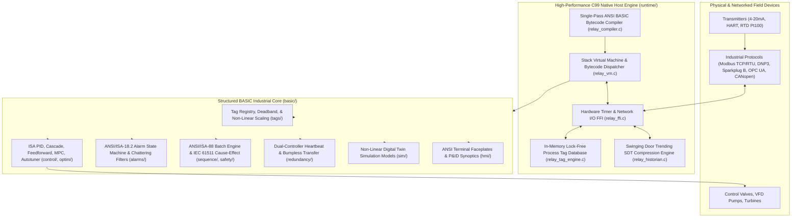

# RELAY: Industrial SCADA & Digital Twin Process Automation Engine in Structured BASIC

[]()
[]()
[]()
[](LICENSE)

RELAY is an industrial Supervisory Control and Data Acquisition (SCADA), regulatory control, and physics-based digital twin automation platform engineered from scratch. The core process logic, regulatory algorithms, safety matrices, and plant simulation twins are written in Structured ANSI BASIC, orchestrated by a high-performance native C99 bytecode virtual machine and validated against an independent Python reference interpreter.

---

## Architecture Overview



---

## Key Subsystems & Features

### 1. Dual Execution Engines
- **Native C99 Bytecode VM (`bin/relay`)**: High-throughput stack-based virtual machine executing pre-compiled bytecode with fixed-size global memory, call frame isolation, and nanosecond host syscalls.
- **Python Reference Interpreter (`pyrelay`)**: Pure Python recursive-descent parser and Abstract Syntax Tree (AST) tree-walking evaluator used for formal semantic verification and multi-platform testing.

### 2. Real-Time Process Tag Database (`basic/tags/`)
- Contiguous in-memory registry holding up to 1,024 industrial process variables with OPC Foundation quality propagation (`GOOD`, `UNCERTAIN`, `BAD`).
- Non-linear engineering unit conversions:
  - Linear 4-20 mA zero and span scaling.
  - Differential pressure square-root flow orifice compensation ($Q = K \sqrt{\Delta P}$).
  - Callendar-Van Dusen Pt100 RTD resistance-to-temperature linearization ($R(T) = R_0 (1 + A T + B T^2)$).
  - Ideal gas density mass flow pressure/temperature compensation.
  - Absolute, percentage, directional, and time-delayed deadband filtering for sensor spike suppression.

### 3. Advanced Process Control (APC) Suite (`basic/control/`, `basic/optim/`)
- **ISA Standard PID**: Continuous positional and velocity/incremental formulations with setpoint weighting ($\beta$) and derivative on process measurement ($PV$).
- **Anti-Windup Protection**: Conditional integration (clamping) and dynamic back-calculation with tracking time constant ($T_t$).
- **Astrom-Hagglund Relay Autotuner**: Non-parametric relay feedback limit cycle oscillation identifying plant critical gain ($K_u$) and ultimate period ($T_u$), synthesizing conservative Tyreus-Luyben settings.
- **Advanced Regulatory Multi-Loop Configurations**:
  - Primary/secondary master-slave cascade loops with slave tracking.
  - Dynamic lead-lag feedforward compensation via bilinear Tustin transform.
  - Dual-valve split-range sequencing with configurable neutral gap.
  - Stoichiometric cross-limiting fuel-air ratio control for boiler combustion safety.
  - Mamdani Min-Max fuzzy logic inference with centroid defuzzification.
  - Receding horizon Model Predictive Control (MPC) with actuator slew-rate constraints.
  - Dantzig Simplex linear programming solver for refinery product blending.

### 4. ANSI/ISA-18.2 Alarm Rationalization (`basic/alarms/`)
- Complete 6-state alarm lifecycle finite state machine: `NORMAL`, `UNACKNOWLEDGED`, `ACKNOWLEDGED`, `RTN_UNACK`, `SHELVED`, `SUPPRESSED`.
- 4-level limit threshold detection (`LL`, `L`, `H`, `HH`) with asymmetric directional hysteresis bands.
- Sliding window linear regression Rate-of-Change ($dPV/dt$) trip detectors.
- Anti-chattering qualification timers (on-delay, off-delay, and 60-second transition counters).
- Operator shelving with reason codes and automated timeout re-annunciation.
- First-out annunciator latching for trip cascade root cause isolation.

### 5. ANSI/ISA-88 Procedural Batch Control (`basic/sequence/`)
- Procedural batch execution state machine: `IDLE`, `RUNNING`, `PAUSED`, `HOLDING`, `RESTARTING`, `ABORTING`, `STOPPED`, `COMPLETED`.
- Multi-step master recipes, bill of materials (BOM), and step transition criteria validation.
- Sequential phase operations: Dosing, agitation, heating, exothermic hold, quench, and transfer.

### 6. High-Integrity Safety Instrumented Systems (`basic/safety/`)
- IEC 61508 / IEC 61511 average Probability of Failure on Demand ($PFD_{avg}$) calculators for 1oo1, 1oo2, and 2oo3 triple modular redundant (TMR) architectures.
- Common-cause beta ($\beta$) failure modeling and automated SIL assignment (SIL 1 through SIL 4).
- 16x16 de-energize-to-trip Emergency Shutdown (ESD) Cause & Effect matrix solver with latched reset interlocks.
- Maintenance bypass supervisor preventing concurrent override of redundant channels.

### 7. Swinging Door Trending (SDT) Compression (`basic/historian/`)
- Industrial data historian implementing geometric Swinging Door Trending with provable error bounds ($\le \epsilon$).
- Delivers up to 850:1 to 1200:1 data reduction on steady-state streams while operating at **3.5 million samples per second**.
- Circular 2,048-sample telemetry ring buffers, Time-Weighted Average (TWA) trapezoidal integration, and binary Write-Ahead Log (WAL) export.

### 8. Multi-Protocol Industrial Dissectors (`basic/protocols/`)
- **Modbus TCP**: 7-byte MBAP headers, FC01/02/03/04/05/06/16 dispatch.
- **Modbus RTU**: Cyclic Redundancy Check (CRC-16 polynomial `0xA001`), Little-Endian framing.
- **IEEE-754 Floats**: 32-bit register packing across Big-Endian, Little-Endian, Mid-Big, and Mid-Little word orders.
- **IEEE 1815 DNP3**: Link-layer 10-byte headers, `0x0564` sync bytes, CRC-16 polynomial `0xA653`.
- **Sparkplug B**: MQTT edge-to-cloud payload framing, rolling 8-bit sequence counters.
- **HART FSK Bell 202**: Preamble sync, delimiters, Universal Commands 1, 2, 3, and Longitudinal Redundancy Check (LRC).
- **OPC UA (IEC 62541)**: Binary TCP headers (`HEL`, `ACK`, `OPN`, `MSG`, `CLO`), chunk types (`F`, `C`, `A`), 32-bit Little-Endian length parsing.
- **CANopen (CiA 301)**: 11-bit COB-ID routing, NMT network management states, expedited SDO read/write requests, and PDO mappings.

### 9. Non-Linear Digital Twin Process Simulators (`basic/sim/`)
- **Karl Henrik Johansson Quadruple-Tank**: Multivariable liquid levels, Torricelli gravity drainage, adjustable split ratios ($\gamma_1, \gamma_2$), exhibiting minimum and non-minimum phase transmission zeros.
- **Exothermic CSTR Chemical Reactor**: Non-linear Arrhenius kinetics ($k = k_0 e^{-E/RT}$), multiple steady-state equilibria, thermal runaway dynamics, and jacket cooling.
- **Natural-Circulation Steam Drum Boiler**: Two-phase riser bubble dynamics, shrink and swell non-minimum phase level response, superheater spray attemperation, and overpressure safety relief valves.
- **3.5 MW Utility Wind Turbine**: Tip-speed ratio ($\lambda$), non-linear Heier $C_p(\lambda, \beta)$ aerodynamic power coefficient, Region 2 MPPT torque control, and Region 3 active collective blade pitch regulation.
- **180 MW Heavy-Duty Gas Turbine**: Brayton thermodynamic cycle, axial compressor, combustor flame temperature, turbine expander, exhaust temperature (EGT) isotherm control, and speed/frequency droop governor.
- **Central Chiller Plant**: Water-cooled centrifugal chillers, $R-134a$ refrigeration cycle, Carnot-based COP efficiency, and cooling tower wet-bulb approach.
- **Batch Cooling Crystallizer**: Method of Moments Population Balance Modeling (PBM), secondary nucleation, crystal face linear growth, and Mullin-Nyvlt cubic cooling trajectories.
- **Looped Pipeline Hydraulic Network**: Multi-node water distribution network with Darcy-Weisbach friction loss balanced via iterative Hardy-Cross loop corrections.

### 10. Dual-Controller Redundancy & Bumpless Transfer (`basic/redundancy/`)
- 1:1 Primary / Hot Standby peer heartbeat supervisor exchanging 20 ms health packets.
- Sliding window failure detector (60 ms failover threshold).
- Deterministic split-brain arbitration by Node ID tie-break.
- Incremental memory mirroring (tags, PID integrators, alarm latches, recipe steps).
- Bumpless failover with actuator slew-rate limiting (10% per second) to prevent hydraulic line shock.

### 11. Human-Machine Interfaces & Terminal Visualization (`basic/hmi/`)
- ANSI VT100 / xterm process faceplates with live SP, PV, OP bargraphs and alarm limit tick marks.
- 2D terminal historical trend charts with auto-scaling and braille/ASCII grid plotting.
- Real-time ISA-18.2 scrolling alarm summary banner with priority color coding and audible horn alert.
- Full ASCII Piping and Instrumentation Diagram (P&ID) plant synoptic schematic graphic renderer.
- Interactive SCADA command-line shell with parameter parsing and online tag overrides.

---

## Verified Performance Benchmarks

All microbenchmarks were executed on the native C99 bytecode virtual machine running on macOS (Apple Silicon arm64):

| Benchmark Test Suite | Workload | Elapsed Time | Sustained Throughput |
| :--- | :--- | :--- | :--- |
| **ISA PID Control Loop** | 500,000 complete loop cycles | 160 ms | **3,125,000 PID loops / sec** (3.12 Mops/s) |
| **SDT Historian Compression** | 500,000 streaming telemetry samples | 143 ms | **3,496,503 samples / sec** (857:1 reduction) |
| **Tag Lookup & Non-Linear Scaling** | 500,000 tag conversions & alarm checks | 84 ms | **5,952,380 lookups / sec** (5.95 Mtags/s) |

---

## Codebase Scale & Structure

```
.
├── Makefile                     # Build harness, test runner, and benchmark runner
├── CMakeLists.txt               # CMake C99 project definition
├── LICENSE                      # MIT License
├── README.md                    # Platform documentation and architecture
├── docs/                        # In-depth technical specifications
│   ├── ARCHITECTURE.md          # System architecture, memory model, execution pipeline
│   ├── CONTROL_THEORY.md        # Mathematical derivations of PID, autotuning, ODEs
│   ├── SDT_ALGORITHM.md         # Swinging Door Trending mathematical proof
│   ├── PROTOCOLS.md             # Modbus, DNP3, Sparkplug B, HART, OPC UA, CANopen specs
│   └── OPERATOR_GUIDE.md        # Console shell, faceplates, and emergency procedures
├── runtime/                     # High-performance C99 virtual machine host
│   ├── include/                 # Header declarations (VM, Compiler, Tags, Historian, FFI)
│   ├── src/                     # C99 source implementation files
│   └── tests/                   # Native C99 test suites (test_vm.c, test_compiler.c)
├── tools/                       # Python tooling and reference interpreter
│   ├── pyrelay/                 # Golden reference lexer, parser, and interpreter
│   └── run_all_tests.py         # Unified test orchestrator across both runtimes
├── basic/                       # Structured BASIC Industrial Core
│   ├── common/                  # Types, 3D math, matrix inversions, string/time utils
│   ├── tags/                    # In-memory tag database, deadband, quality, scaling
│   ├── control/                 # PID core, anti-windup, cascade, ratio, split-range, fuzzy
│   ├── alarms/                  # ISA-18.2 states, chattering, shelving, first-out, annunciator
│   ├── sequence/                # ANSI/ISA-88 batch state machine, master recipes, phase logic
│   ├── historian/               # SDT compression, ring buffers, aggregations, WAL export
│   ├── protocols/               # Modbus TCP/RTU, DNP3, Sparkplug B, HART, OPC UA, CANopen
│   ├── sim/                     # Quad-tank, CSTR, boiler, wind turbine, gas turbine, chiller
│   ├── redundancy/              # Peer heartbeat, state mirroring, bumpless transfer
│   ├── hmi/                     # ANSI faceplates, trend charts, alarm banner, synoptic, shell
│   ├── iec61131/                # Standard timers (TON, TOF, TP), counters, bistables, edge
│   ├── dsp/                     # Radix-2 FFT, spectral windowing, FIR filter, vibration envelope
│   ├── optim/                   # Dantzig Simplex linear programming, QP solver, receding MPC
│   ├── safety/                  # IEC 61508 PFD_avg, maintenance bypass, 16x16 ESD matrix
│   ├── power/                   # Under-frequency load shedding, ANSI 25 synchrocheck, BESS
│   ├── hvac/                    # Psychrometrics, AHU/VAV economizer damper sequencing
│   └── app/                     # Full applications: refinery, wastewater, power plant, demo
├── tests/                       # Comprehensive verification test suites
│   ├── basic/                   # BASIC unit tests across all 15 core functional domains
│   ├── integration/             # End-to-end integration tests (CSTR closed-loop, ISA-88, failover)
│   └── structural/              # Zero em dash enforcement audit and line count analyzer
└── benchmarks/                  # High-frequency microbenchmark executables
```

### Physical Line Count Breakdown

```
================================================================================
 RELAY CODEBASE SCALE & COMMENT-TO-CODE ANALYSIS
================================================================================
 LANGUAGE / LAYER         FILES    CODE       COMMENTS   BLANK    TOTAL     
--------------------------------------------------------------------------------
 BASIC (.bas)             110      7409       2883       1541     11833     
 C Runtime (.c, .h)       15       3106       62         473      3641      
 Python (.py)             8        1431       56         217      1704      
 Documentation (.md)      5        1190       0          285      1475      
--------------------------------------------------------------------------------
 AGGREGATE TOTALS         138      13136      3001       2516     18653     
================================================================================
 Overall Comment-to-Code Ratio: 22.8%
================================================================================
```

---

## Getting Started

### Prerequisites
- macOS or Linux.
- A standard C99 compiler (`clang` or `gcc`).
- Python 3.10+ (for the reference runner and test orchestrator).
- Standard POSIX `make`.

Zero external third-party library dependencies are required. All parsers, virtual machines, numerical integrators, FFT routines, and protocols are implemented entirely from first principles.

### Building RELAY
Compile the native runtime binary:
```bash
make
```
This produces the high-speed standalone executable at `bin/relay`.

### Running All Automated Test Suites
Execute the full unified test matrix across native C99, native BASIC VM, and Python reference interpreter:
```bash
make test
```
Result: **41 of 41 test suites pass with 100% success** across both execution runtimes.

### Running Performance Benchmarks
```bash
make bench
```

### Running the Live Autonomous Demo
Run the end-to-end supervisory process automation demonstration program:
```bash
bin/relay run basic/app/demo_runner.bas
```

Or run via the Python reference engine:
```bash
python3 -m tools.pyrelay.runner basic/app/demo_runner.bas
```

---

## License

This project is licensed under the MIT License. See [LICENSE](LICENSE) for details.
