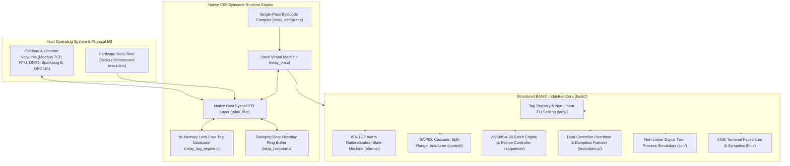
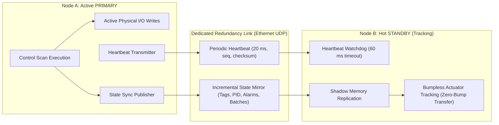

# RELAY System Architecture & Execution Model

RELAY is an industrial Supervisory Control and Data Acquisition (SCADA) and digital twin process automation platform engineered in Structured ANSI BASIC with a high-performance C99 virtual machine host and Python reference runtime.

This document details the architectural topology, memory layout, real-time scan cycle execution pipeline, and multi-subsystem dataflow.

---

## 1. High-Level Architectural Topology



---

## 2. Real-Time Scan Cycle Execution Pipeline

RELAY executes deterministic scan cycles modeled on the IEC 61131-3 standard for programmable logic controllers. Each scan cycle completes within a fixed time budget (default 50 milliseconds; configurable down to 1 millisecond for high-speed servo and microgrid loops).

```mermaid
sequenceDiagram
    participant Field as Field Transmitters & I/O
    participant FFI as Host FFI & Protocols
    participant TagDB as Tag Engine & Deadbands
    participant Alarm as ISA-18.2 Alarm Engine
    participant Control as Regulatory Control (PID/MPC)
    participant Batch as ISA-88 Sequence Engine
    participant Twin as Digital Twin Simulator
    participant Redundancy as Hot-Standby Mirror
    participant Hist as SDT Historian

    Note over Field,Hist: Periodic Scan Cycle Start (e.g. t = k * 50 ms)
    Field->>FFI: Ingest Modbus/DNP3 Telemetry Frames
    FFI->>TagDB: Write Raw ADC & Quality Status
    TagDB->>TagDB: Engineering Units Scaling & Deadband Filtering
    TagDB->>Alarm: Process Variable (PV) Feed
    Alarm->>Alarm: 4-Level Limit Detection & Chattering Qualification
    TagDB->>Control: Measured Process Values (PV) & Setpoints (SP)
    Control->>Control: Compute Loop Outputs (OP) with Anti-Windup Clamping
    Control->>Batch: Phase Permissives & Interlock Flags
    Batch->>Batch: Recipe Step Transitions & SIS Matrix Evaluation
    Control->>Twin: Actuator Manipulated Variables
    Twin->>Twin: Integrate Non-Linear Differential Equations (Torricelli/Arrhenius)
    Control->>Redundancy: Delta State Replication & Heartbeat Packet
    Redundancy->>Redundancy: Watchdog & Split-Brain Role Verification
    TagDB->>Hist: Telemetry Ingestion
    Hist->>Hist: Online Geometric Door Slope Evaluation (SDT Compression)
    Control->>Field: Dispatch Commanded Actuator Positions
    Note over Field,Hist: Scan Cycle Complete; Sleep Until Next Tick
```

---

## 3. Memory Architecture & Storage Layout

### 3.1. Virtual Machine Memory Model

The native virtual machine allocates dedicated segments to ensure zero heap fragmentation during long-term continuous operation:

1. **Evaluation Stack (`vm->stack`)**:
   Fixed 65,536-entry array of 64-bit tagged unions (`Value`). Operates as an evaluation register stack for bytecode arithmetic, logical operators, and intrinsic function parameter passing.

2. **Call Frame Stack (`vm->frames`)**:
   Fixed 2,048-entry call stack. Each frame preserves the instruction pointer (`ip`), current bytecode chunk pointer (`chunk`), and base stack pointer offset (`slots`) for local subroutine execution.

3. **Global Variable Table (`vm->globals`)**:
   Fixed 4,096-entry global variable storage. In a single-pass BASIC compiler, top-level identifiers are assigned stable indices in this table, preventing stack clobbering across statement boundaries.

4. **Constant Pool (`chunk->constants`)**:
   Per-chunk deduplicated table storing 64-bit IEEE double floats, 64-bit integers, and interned string references.

### 3.2. Tag Database Layout

The tag engine maintains up to 1,024 industrial process variables in a contiguous array:

- **Tag Identifier**: 32-character null-terminated string (e.g. `TK101.LEVEL`).
- **Data Representation**: Double-precision floating point value, integer raw count, and quality byte.
- **Quality Encoding**: Aligned with OPC Foundation standards:
  - `192` (0xC0): Good (Non-specific)
  - `64`  (0x40): Uncertain
  - `0`   (0x00): Bad (Sensor failure / Loop break)
- **Deadband Buffer**: Last archived value, last logged timestamp, and deadband percentage for spike suppression.

### 3.3. Swinging Door Trending (SDT) Historian Buffer

The historian operates an in-memory circular ring buffer holding 2,048 compressed points per series across 32 registered telemetry series. Memory layout is static and bounded to eliminate dynamic heap allocations:

- `Buffer Capacity`: 2,048 samples per series.
- `Series Count`: 32 concurrent measurement channels.
- `Total Footprint`: Approximately 1.5 megabytes across all series, fitting entirely within L2/L3 CPU cache lines for high-throughput access (3.5+ million samples per second).

---

## 4. Dual-Redundant Controller Synchronization

For mission-critical process plants, RELAY supports dual-redundant 1:1 controller configurations (Primary and Hot Standby):



### Failover Mechanics
1. **Heartbeat Loss Detection**: Standby increments a missed-beat counter if no packet arrives within 20 milliseconds. If elapsed silence exceeds 60 milliseconds (3 dropped beats), Standby declares Primary dead.
2. **Deterministic Promotion**: If Standby self-health is healthy, it promotes itself to Primary.
3. **Split-Brain Arbitration**: If network partition causes both controllers to believe they are Primary, the lower Node ID wins the tie-break and the higher Node ID immediately yields to Standby.
4. **Bumpless Transfer Slew**: Upon promotion, the newly active controller locks onto the last known valve readback and ramps outputs through a rate-of-change limiter (10% per second), preventing hydraulic surges.

---

## 5. Dual Compilation & Execution Architecture

RELAY features two independent execution engines that share an identical grammar and language specification:

1. **Native C99 Bytecode VM (`bin/relay`)**:
   Single-pass recursive descent compiler translating Structured BASIC into compact bytecode, executed by a dispatch loop with host syscall intrinsics. Designed for maximum throughput (3+ million loop cycles per second).

2. **Python Reference Interpreter (`pyrelay`)**:
   Abstract Syntax Tree (AST) tree-walking interpreter written in pure Python. Serves as a golden reference model for formal verification, semantic checking, and headless rapid testing.
